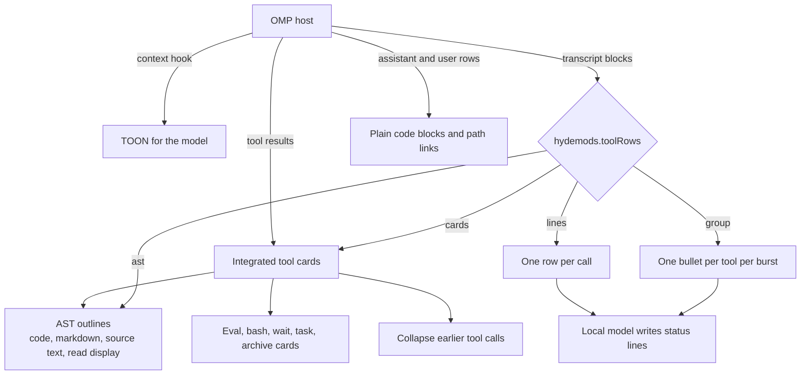

# omp-collapsed


Compacted tool-result views for [Oh My Pi (OMP)](https://github.com/can1357/oh-my-pi). It redraws tool calls and their results as short cards, one-line rows, or per-burst summaries, and shows source code as declaration outlines. The model sees the same results as TOON, a compact table form.

It is the card and row part of [hydemods](https://github.com/emmahyde/hydemods), split into its own extension.

# Replaces hydemods cards and rows

- Run omp-collapsed **instead of** the card and row features of hydemods. Both extensions wrap the same OMP tool renderers, so running both draws every card twice.
- Setting names stay `hydemods.*`, so a `settings.yaml` that already tunes hydemods keeps working.
- The panel command is `/collapsed` (hydemods keeps `/hydemods`). The tool-card toggle is Ctrl+Shift+T and the rows cycle is Ctrl+N, as in hydemods.

# Install

You need [Bun](https://bun.sh) and git on your PATH.

1. Run the installer:

   ```sh
   curl -fsSL https://raw.githubusercontent.com/emmahyde/omp-collapsed/main/install.sh | sh
   ```

2. Restart OMP, or run `/reload-plugins`.
3. Open `/collapsed` to see the tweaks. All of them start on.

The installer clones into `~/.omp/agent/extensions/omp-collapsed` and runs `bun install`. `OMP_COLLAPSED_DIR` and `OMP_COLLAPSED_REPO` override the destination and the source.

# How it fits together



# Tool rows modes

`hydemods.toolRows` (in `/settings`, Tools) picks how tool calls draw. Ctrl+N cycles `cards → ast → lines → group` and flashes the mode that is on. Ctrl+O shows the full cards in any mode.

## cards

Standard OMP cards, 

## AST

Cards with source shown as declarations instead of raw text.


- **Reads and writes** show the declaration outline. Writes add LSP diagnostics. A module or namespace that only wraps one class folds into its row (`class Shop::Billing::Invoice < Base`), so the class's methods show.
- **Edits** show the declarations they touched. Ctrl+O shows the changed lines.
- **Grep** hits show their enclosing declaration.
- **Markdown** files show a heading outline.
- **Bash** output that prints source (`cat`, `sed -n`) is outlined too.
- Declarations are parsed with tree-sitter. Bodies fold to a line count. Comments and line-number gutters are always stripped from displayed source.
- In `lines` and `group` mode, the **AST structuring** tweak decides whether Ctrl+O cards use outlines. In `cards` mode they are never used.

## lines

One row per call, on adjacent rows with no gap, in three aligned columns: the tool, a status line, and the file in the path colour.


- Each tool has its own label colour from the theme. A bash row shows the program its command runs, past any leading `cd dir &&`.
- The status line is the intent (`i`) the agent wrote for the call, exactly as written. A call without one gets a line from a local model, in the agent's voice and never naming the tool. Until it lands, the row shows the call's main argument in dim italics.
- Read file labels link to the original local path. Cmd+click opens the file. Missing files stay plain text.
- Task rows read `Task  <what the subagents were sent to do>  <first agent> +N`, with the subagent footer under the row.
- Eval rows show the first file the code names in the file column.
- Giles tool calls get readable labels (for example `GILES:WK:CHK`); this extension only labels them.

## group

While the agent works, a burst lists its calls one per row, as in `lines`. When the agent replies, or you send a message, the calls give way to a status row and one bullet per distinct tool, in the order the tools were first used: the tool, what the agent used it for, and what came of it.


- A long bullet wraps under its own text. In `group` mode the Task subagent footer stays under the Task bullet.
- A local model writes the bullets from the steps as they stand when the burst ends, with the most weight on edits, failed steps, and the last steps. Until they land, or if the model is down, each bullet is the line of the tool's last call.
- A run spans the thinking and harness notices between its calls; they hide inside the run. A reply or a prompt ends it.
- A run's rows reach scrollback once the run ends and its lines land (at most 4 seconds after).
- **Wiki badges.** A `◆` before a row's file marks that the knowledge wiki (`~/.llm-wiki`, or `.llm-wiki` in the working folder) has a page whose title, slug or tags name that file's stem or the skill. Stems shorter than 4 letters never match.
- **Pills.** With `hydemods.toolPills` on, each row's tool label is drawn as a pill: upper case, bold, the tool's colour as the fill, and black or white text by the fill's brightness. Without truecolour, the pill is drawn in reverse video.

# Keys and commands

- **Ctrl+O** expands every card to its full output, in any mode.
- **Ctrl+N** cycles the tool rows mode (`cards → ast → lines → group`).
- **Ctrl+Shift+T** turns omp-collapsed's card rendering off and on for the session.
- **`/collapsed`** opens the tweak panel. Up/Down select, Space toggles, Left/Right and +/- change the collapsed height, Esc closes.
- **`/collapsed collapsed-lines N`** sets how many content rows a collapsed card shows (default 5).

# Settings

Settings live in OMP's `settings.yaml` under the `hydemods.` prefix. The panel and `/settings` (Tools) edit them.

- `hydemods.toolRows`: `cards`, `ast`, `lines`, or `group` (default `group`).
- `hydemods.toolRowsModel`: the local model that writes row lines (`omp tiny-models` lists them; default `llama3.2:3b`). Set `providers.tinyModelDevice` to `mlx` to run it on the Apple GPU. Call arguments never leave the machine.
- `hydemods.toolPills`: draw row labels as pills (default off).
- `hydemods.wikiBadges`: the `◆` wiki badge (default on).
- `hydemods.collapsedLines`: rows in a collapsed card (default 5).
- `hydemods.integratedToolExpansion`: integrated tool cards.
- `hydemods.toolResultsToon`: TOON in cards and model context.
- `hydemods.evalCommandSummaries`: a short intent summary on each Eval card, from the tiny model.
- `hydemods.astStructuring`: declaration outlines.
- `hydemods.plainCodeBlocks`: tint untagged fenced blocks.
- `hydemods.toolRuns`: collapse earlier tool calls.
- `hydemods.pathLinks`: clickable paths.

# Development

Bun, no build step. From the repository root:

1. `bun install`
2. `bun run test` runs the unit tests against the modules of the OMP that `omp` on your `PATH` provides. It skips itself if `omp` is missing.
3. `bun run typecheck` links the `@oh-my-pi/*` types of that OMP into `node_modules`, then runs `tsc --noEmit`.
4. To test end to end, install the extension (see Install), edit `index.ts`, and run `/reload-plugins`.

Layout:

- `index.ts`: the extension entry. It wraps OMP's tool renderers, installs the rows and runs, and registers `/collapsed`.
- `lib/tool-output.ts`, `lib/source-text.ts`, `lib/code-outline.ts`, `lib/read-display.ts`: output formatting and AST outlines.
- `lib/tool-rows.ts`, `lib/tool-rows-host.ts`, `lib/tool-labels.ts`: rows planning, drawing, and labels.
- `lib/tool-runs.ts`: collapse earlier tool calls.
- `lib/eval-*.ts`, `lib/archive-output.ts`, `lib/wait-status.ts`, `lib/task-card.ts`: per-tool cards.
- `lib/transcript-rows.ts`, `lib/plain-blocks.ts`, `lib/path-links.ts`: plain code blocks and path links in message rows.
